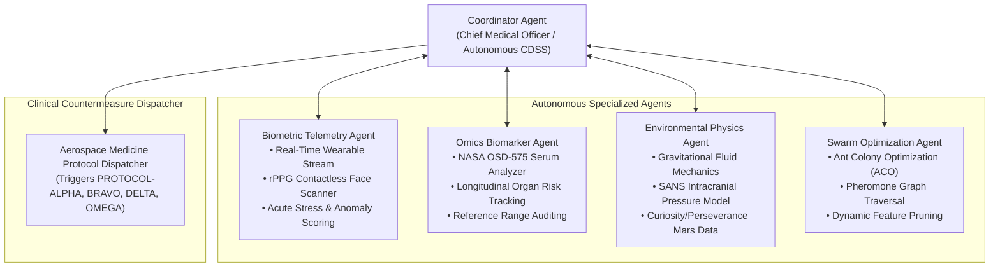

# 🤖 Autonomous Agent Ecosystem: NASA Flight Health Network

## 1. Multi-Agent System Architecture
For deep-space exploration where light-speed delays prevent synchronous telemedicine from Earth, the platform implements a coordinated **Multi-Agent Autonomous Clinical Network**.

---

## 2. Specialized Agent Roles & Responsibilities

### 1. `BiometricTelemetryAgent`
- **Role**: Continuous in-flight monitoring of physiological sensors and video feeds.
- **Tools**: `rppg_engine`, `IsolationForest`, `GradientBoostingStressClassifier`.
- **Inputs**: 700 Hz ECG, respiration, EDA, skin temperature, 3-axis acceleration, and webcam frames.
- **Outputs**: Acute stress probability $P(\text{stress})$, anomaly severity %, Heart Rate (bpm), HRV RMSSD (ms), Respiration (br/min), and Fatigue index.
- **Autonomy Level**: Continuous background streaming; interrupts coordinator immediately upon detecting cardiac arrhythmias or vagal collapse.

### 2. `OmicsBiomarkerAgent`
- **Role**: Longitudinal molecular surveillance across mission phases.
- **Tools**: `OrganRiskEngine`, `osd575_features.csv` database.
- **Inputs**: 921 serum analytes across pre-flight (`L-92` to `L-3`), post-landing (`R+1`), and recovery (`R+45` to `R+194`).
- **Outputs**: Organ System Risk Scores (Renal, Hepatic, Immune, Cardiovascular), fold changes, and clinical reference range violations (`out_of_range`).
- **Autonomy Level**: Batch analysis on scheduled mission days or after blood draws.

### 3. `EnvironmentalPhysicsAgent`
- **Role**: Planetary environment, radiation dosimetry, and spaceflight biomechanics.
- **Tools**: `SpaceEnvironmentSimulator`, NASA Mars Curiosity RAD / Perseverance MEDA database.
- **Inputs**: Gravitational field ($G$), cabin pressure ($P$), $FiO_2$, ambient $\text{CO}_2$, cosmic radiation flux ($\mu\text{Sv/h}$), and mission duration.
- **Outputs**: Cephalad fluid shift index, SANS risk & optic nerve dilation (mm), skeletal bone resorption rate, hypercalciuria stone risk, and cumulative radiation dose vs NASA career limits.
- **Autonomy Level**: Real-time evaluation during planetary transitions, orbital maneuvers, and habitat depressurization.

### 4. `SwarmOptimizationAgent`
- **Role**: Dynamic, evolutionary feature selection and telemetry compression.
- **Tools**: `AntColonyFeatureSelector`.
- **Inputs**: High-dimensional physiological feature vectors.
- **Outputs**: Optimal minimal feature subsets, pheromone trail maps, and swarm convergence metrics.
- **Autonomy Level**: Triggered when sensor channels are degraded, bandwidth is restricted, or onboard computing power must be conserved.

### 5. `FlightSurgeonCoordinator`
- **Role**: Executive synthesis, whole-body Astronaut Health Readiness Index (AHRI) computation, and clinical countermeasure dispatch.
- **Tools**: `MultimodalFusionEngine`, SQLite database logging.
- **Protocol Dispatch**:
  - `PROTOCOL-ALPHA`: Autonomic Down-Regulation (0.1 Hz Paced Breathing) for acute sympathetic crisis.
  - `PROTOCOL-BRAVO`: Renal Fluid & Electrolyte Beverage for hypercalciuria or hypovolemic fluid shift.
  - `PROTOCOL-DELTA`: Immune Suppression & Dark-Enclosure for post-flight inflammatory/cytokine surges.
  - `PROTOCOL-OMEGA`: Immediate EVA Abort & Emergency Telemedicine Burst for severe vital anomalies.

---

## 3. Communication & Messaging Protocols
- **Message Format**: JSON Lines (JSONL) with ISO 8601 timestamps, astronaut ID, priority level (`LOW`, `NORMAL`, `HIGH`, `CRITICAL`), and payload.
- **Inter-Agent Bus**: In-memory message dispatcher supporting reactive wake-up without polling.
- **Audit Logging**: All inter-agent decisions, triage transitions, and countermeasure authorizations are permanently recorded in `data/astronaut_health.db` under the `clinical_alerts` table.
