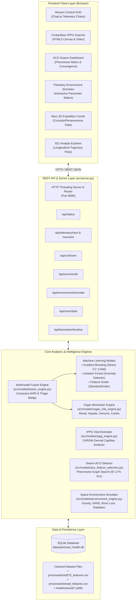
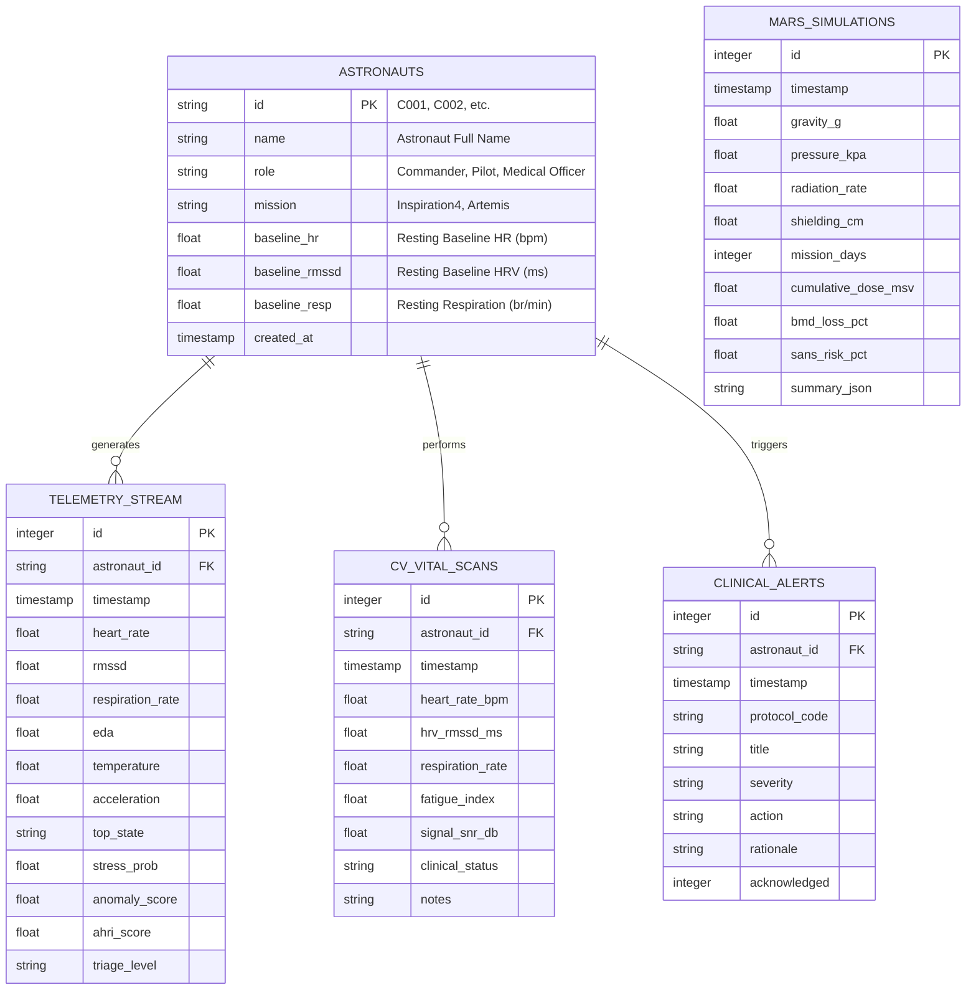

# 🏛️ System Architecture: NASA Astronaut Health CDSS

## 1. High-Level Architecture Diagram

---

## 2. Database Entity-Relationship (ER) Schema

The persistence layer is implemented in `src/database/db.py` using SQLite (`data/astronaut_health.db`):

---

## 3. REST API Interface Specification

| Endpoint | Method | Parameters | Description |
|---|---|---|---|
| `/` or `/index.html` | `GET` | None | Serves the Mission Control Web Dashboard. |
| `/api/status` | `GET` | None | Returns server health, model metadata, and crew member IDs. |
| `/api/crew` | `GET` | `timepoint` (e.g. `R+1`) | Returns multi-organ risk profiles for all 4 Inspiration4 astronauts. |
| `/api/telemetry/next` | `GET` | `astronaut`, `timepoint` | Advances simulator and executes multimodal fusion evaluation. |
| `/api/telemetry/scenario` | `GET` | `name` (`nominal`, `eva`, `stress`, `anomaly`), `astronaut`, `timepoint` | Injects controlled aerospace mission scenario. |
| `/api/telemetry/set_subject`| `GET` | `subject` (`S2`–`S17`) | Sets the active WESAD wearable streaming subject. |
| `/api/biomarker/timeline` | `GET` | `subject`, `analyte` | Queries longitudinal trajectory across `L-92` to `R+194`. |
| `/api/aco/results` | `GET` | None | Retrieves Ant Colony Optimization feature selection results, pheromones, and convergence history. |
| `/api/environment/simulate`| `GET` | `preset`, `gravity`, `pressure`, `o2`, `co2`, `radiation`, `days` | Computes gravitational and atmospheric physiological responses. |
| `/api/mars/data` | `GET` | None | Returns empirical Curiosity RAD & Perseverance MEDA Mars data. |
| `/api/cv/frame` | `POST` | `{ r, g, b, timestamp }` | Ingests facial dermal capillary color samples and returns rPPG estimates. |
| `/api/predict` | `POST` | Custom JSON telemetry packet | Performs real-time inference on arbitrary biometric data. |

---

## 4. Security & Isolation Boundaries

- **Zero External Egress**: The inference engines, database, and computer vision algorithms execute entirely in-process without transmitting data over the public internet.
- **Microgravity Edge Deployment**: Designed to run directly on the spacecraft's local computing server (e.g. Astrobee / ISS onboard network) with no dependency on ground connectivity.
