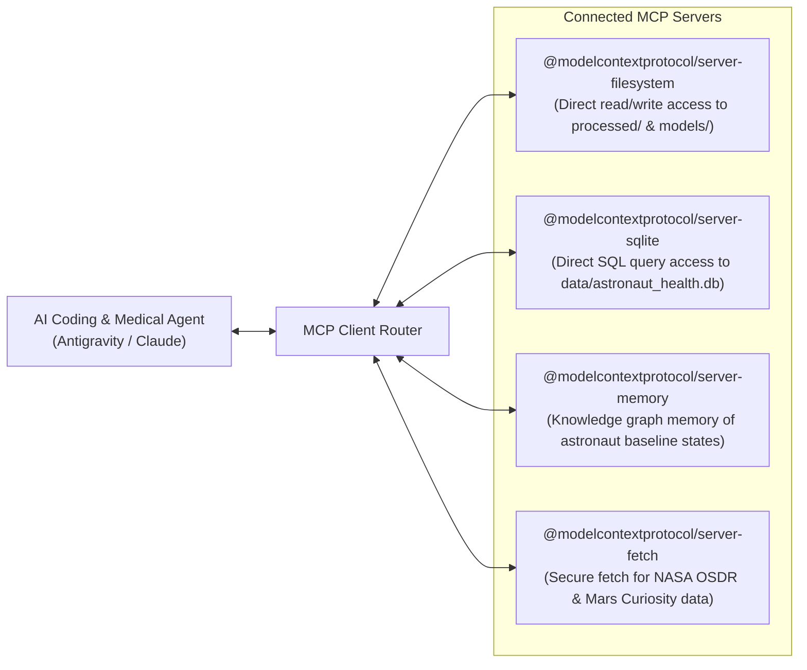

# 🔌 Model Context Protocol (MCP) Configuration Guide

## 1. Overview of MCP in the NASA CDSS Architecture
The **Model Context Protocol (MCP)** provides open-standard connectivity between AI agents, local datasets, databases, and flight systems. In the NASA Astronaut Health CDSS, MCP servers grant the agent verified access to local filesystem telemetry files, SQLite clinical logs, and automated browser testing.

---

## 2. Recommended MCP Servers



### Server Descriptions:
1. **`filesystem`**: Grants the agent direct, sandboxed access to workspace folders (`processed/`, `models/saved/`, `data/`).
2. **`sqlite`**: Allows the agent to run read-only and analytical SQL queries on `data/astronaut_health.db` (e.g. querying historical vital scans or alert frequencies).
3. **`memory`**: Provides a persistent graph memory store for crew clinical history, Flight Surgeon notes, and mission logs across conversation restarts.
4. **`fetch`**: Ingests updated NASA Open Science Data Repository (OSDR) study files or Mars rover atmospheric updates.

---

## 3. Configuration Setup

Add the following configuration to your `mcpSettings.json` or Antigravity / Claude settings file:

```json
{
  "mcpServers": {
    "nasa-cdss-filesystem": {
      "command": "npx",
      "args": [
        "-y",
        "@modelcontextprotocol/server-filesystem",
        "C:\\Users\\HP\\Documents\\nasa ai hackhathon"
      ]
    },
    "nasa-cdss-database": {
      "command": "npx",
      "args": [
        "-y",
        "@modelcontextprotocol/server-sqlite",
        "C:\\Users\\HP\\Documents\\nasa ai hackhathon\\data\\astronaut_health.db"
      ]
    },
    "nasa-cdss-memory": {
      "command": "npx",
      "args": [
        "-y",
        "@modelcontextprotocol/server-memory"
      ]
    },
    "nasa-cdss-fetch": {
      "command": "npx",
      "args": [
        "-y",
        "@modelcontextprotocol/server-fetch"
      ]
    }
  }
}
```

---

## 4. Verifying MCP Connectivity

Once configured:
1. Restart your agent environment.
2. In the chat, query:
   > *"Using the SQLite MCP server, show the most recent clinical alerts in the database."*
   The agent will invoke `sqlite_query` on `data/astronaut_health.db` and return the formatted records.
3. To inspect memory:
   > *"What is Commander C001's resting baseline heart rate?"*
   The agent will retrieve the node from the memory graph and answer accurately.
