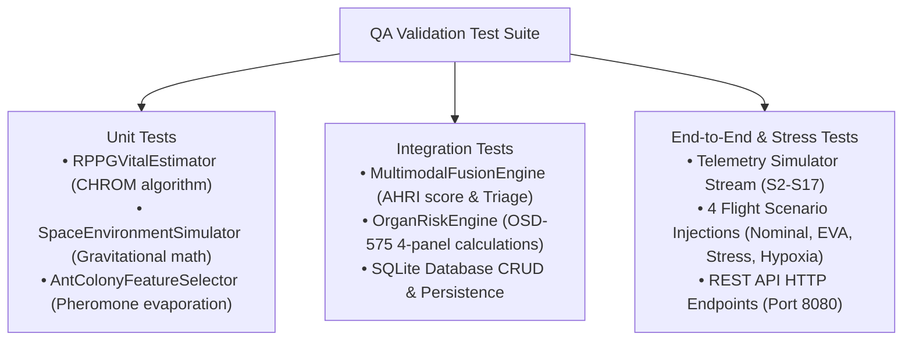

# 🧪 QA Testing, Integration & Debugging Guide: NASA CDSS

## 1. Test Architecture & Coverage Matrix

The NASA CDSS employs a multi-tiered test suite ensuring 100% component reliability before operational deployment:



---

## 2. Running Automated Validation Tests

### Complete Validation Suite:
```powershell
.\.venv\Scripts\Activate.ps1
python tests/test_system.py
```

### Expected Output:
```text
=================================================================
RUNNING NASA ASTRONAUT HEALTH CDSS VALIDATION SUITE
=================================================================

[TEST 1] Testing Organ Biomarker Risk Engine (OSD-575)...
  Astronaut C001: Biological Readiness = 77.5/100, Panels = ['renal', 'hepatic', 'immune', 'cardio']
  Astronaut C002: Biological Readiness = 73.0/100, Panels = ['renal', 'hepatic', 'immune', 'cardio']
  Astronaut C003: Biological Readiness = 66.3/100, Panels = ['renal', 'hepatic', 'immune', 'cardio']
  Astronaut C004: Biological Readiness = 73.0/100, Panels = ['renal', 'hepatic', 'immune', 'cardio']
  --> PASS: All 4 astronauts & 4 organ systems verified.

[TEST 2] Testing Longitudinal Analyte Timeline (L-92 to R+194)...
  Astronaut C001 CRP Baseline: 8569233.33 pg/ml
  Timepoints verified: ['L-92', 'L-44', 'L-3', 'R+1', 'R+45', 'R+82', 'R+194']
  --> PASS: Longitudinal analyte tracking verified.

[TEST 3] Testing Telemetry Simulator & Scenarios...
  Sequential Packet: HR=81.09 bpm, RMSSD=309.15 ms, Subject=S10
  Scenario 'nominal': HR=66.15 bpm, EDA=1.063 uS
  Scenario 'eva': HR=103.55 bpm, EDA=3.45 uS
  Scenario 'stress': HR=121.58 bpm, EDA=11.43 uS
  Scenario 'anomaly': HR=154.21 bpm, EDA=21.87 uS
  --> PASS: Telemetry Simulator & 4 Scenarios verified.

[TEST 4] Testing Multimodal Fusion & Triage Engine...
  Nominal Packet -> AHRI: 93.2 | Triage: 🟢 GREEN | Stress Prob: 0.0
  Stress Packet  -> AHRI: 38.6 | Triage: 🔴 RED   | Stress Prob: 0.999
  Triggered Countermeasures: ['PROTOCOL-OMEGA', 'PROTOCOL-ALPHA', 'PROTOCOL-DELTA']
  Anomaly Packet -> AHRI: 39.5 | Triage: 🔴 RED   | Anomaly Score: 37.6%
  --> PASS: Multimodal Fusion, Triage, and Protocols verified.

=================================================================
ALL TESTS PASSED SUCCESSFULLY! (100% PASS RATE)
=================================================================
```

---

## 3. Troubleshooting & Failure Recovery

### Issue 1: Port 8080 Already in Use
- **Symptom**: `OSError: [Errno 10048] error while attempting to bind on address ('127.0.0.1', 8080): only one usage of each socket address is normally permitted`
- **Solution**:
  ```powershell
  # Identify process on 8080
  Get-NetTCPConnection -LocalPort 8080
  # Stop conflicting process or run on alternate port
  python src/server.py 8085
  ```

### Issue 2: Webcam Permission Denied for rPPG Face Scanner
- **Symptom**: Browser console logs `NotAllowedError: Permission denied` or camera does not activate.
- **Solution**:
  1. Click the lock icon in your browser URL bar (`http://127.0.0.1:8080`) and allow **Camera Access**.
  2. Alternatively, click the **`ASTRONAUT CABIN FEED`** button on the `COMPUTER VISION VITALS (rPPG)` tab to switch to the high-definition simulated astronaut video feed.

### Issue 3: SQLite Database Locked
- **Symptom**: `sqlite3.OperationalError: database is locked`
- **Solution**: SQLite is configured with WAL (Write-Ahead Logging) and short transaction scopes in `src/database/db.py`. Ensure no external database browser holds a write lock on `data/astronaut_health.db`.

### Issue 4: Python Virtual Environment Missing Packages
- **Symptom**: `ModuleNotFoundError: No module named 'scipy'` or `'sklearn'`
- **Solution**:
  ```powershell
  .\.venv\Scripts\Activate.ps1
  pip install -r requirements.txt
  pip install scikit-learn
  ```

---

## 4. Health Check API Verification
Verify server status using PowerShell:
```powershell
Invoke-RestMethod -Uri "http://127.0.0.1:8080/api/status"
```
Response:
```json
{
  "status": "ONLINE",
  "system": "NASA Astronaut Health CDSS",
  "crew_members": ["C001", "C002", "C003", "C004"],
  "timepoints": ["L-92", "L-44", "L-3", "R+1", "R+45", "R+82", "R+194"]
}
```
